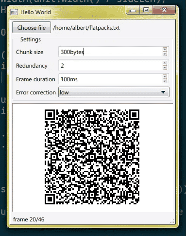

A mostly vibe-coded TypeScript rewrite of [divan/txqr](https://github.com/divan/txqr). Written for use in both web and desktop apps.

### Web

Compiles to a single JS file (~60kb) and a `.d.ts` for typescript.

### Desktop

See `qt-demo/`. The decoder has a method that you can pass decoded QR code data, meaning you can do QR code reading natively and not in the JS.



---

# txqr (TypeScript)

send data through an animated sequence of QR codes. It uses a fountain code, so the
receiver can start at any frame and recover from missed frames.

Build output (committed, so it can be used without building):

- `dist/txqr.mjs`: one self-contained ES module, with paulmillr's
  [`qr`](https://github.com/paulmillr/qr) included. It uses only ES2016 and plain
  ECMAScript (no DOM, `TextEncoder` or timers), so the same file runs in browsers,
  QuickJS and Qt's QML engine.
- `dist/txqr.d.ts`: TypeScript declarations.
- `dist/demo.html`: the test page as one static file. Open it directly; no server needed.

## Tasks (Deno)

```sh
deno task build        # type-check, then write everything in dist/
deno task test         # Deno tests on the source, then QuickJS on dist/txqr.mjs (needs qjs)
deno task test:qml     # Qt QML engine on dist/txqr.mjs (needs qml6, Qt 6.8+)
deno task check        # type-check everything
deno task serve        # test page on http://<host>:8000/ (build first)
deno task serve:https  # same on https://<host>:8443/, needed for phone cameras
```

## Usage

```js
import * as TxQR from "./txqr.mjs";

const enc = new TxQR.Encoder(bytesOrString, { chunkSize: 100 });
// Cycle through frames 0..enc.frameCount-1 on your own timer, showing each with
// enc.renderSVG(i), renderImage(i) (RGBA pixels) or renderMatrix(i) (module grid).

const dec = new TxQR.Decoder();
dec.pushImage({ width, height, data });  // camera frame, RGBA (or set opts.format)
if (dec.complete) use(dec.bytes());
```

### Decoding QR codes outside JS

QR reading from pixels is the slowest part in embedded engines. You can skip it
entirely: decode the QR codes natively (e.g. with ZXing or a platform scanner) and pass
only each code's content to the decoder:

```js
dec.push(qrText);    // the decoded QR code as a string
dec.pushBytes(raw);  // or its raw payload bytes (Uint8Array or ArrayBuffer)
```

Both return `true` once the message is complete. They throw on content that isn't a txqr
frame, so if the scanner may see other QR codes, filter them with `TxQR.Decoder.isFrame(x)`,
which accepts the same inputs. `pushImage` ignores other QR codes itself.

From QML: `import "txqr.mjs" as TxQR`, then `new TxQR.Encoder(...)`. Qt 6.8's
incremental garbage collector can crash under this library's allocation load. Set
`QV4_GC_TIMELIMIT=0` in the app's environment to avoid it.

Options and their defaults (from the original `txqr-gif` tool), exported as `DEFAULTS`:

| option          | default    | meaning                                |
| --------------- | ---------- | -------------------------------------- |
| `chunkSize`     | 100        | payload bytes per frame                |
| `redundancy`    | 2          | frames per loop = blocks × redundancy  |
| `size`          | 300 px     | rendered QR width/height               |
| `ecc`           | `"medium"` | `low` / `medium` / `quartile` / `high` |
| `border`        | 4          | quiet zone, in modules                 |

Frame timing is up to the app; the library has no clock. The original showed each
frame for 200 ms (5 FPS), which is what the demo page defaults to.

## Differences from the Go original (not wire-compatible)

- Frames are `code/chunkSize/size/CRC32:base45data`. Every character is in QR's
  alphanumeric set, which stores about 1.37× more data per code than the original's
  base64-in-byte-mode.
- The fountain code is systematic: the first k frames are the plain blocks. Later frames
  are sparse random XOR combinations, decoded by incremental Gaussian elimination.
  Recovery needs about k + 1.5 frames on average, whatever order or losses they arrive in.
- A CRC-32 of the whole message checks the result and identifies the transfer, so the
  decoder resets itself when a different transfer starts.
